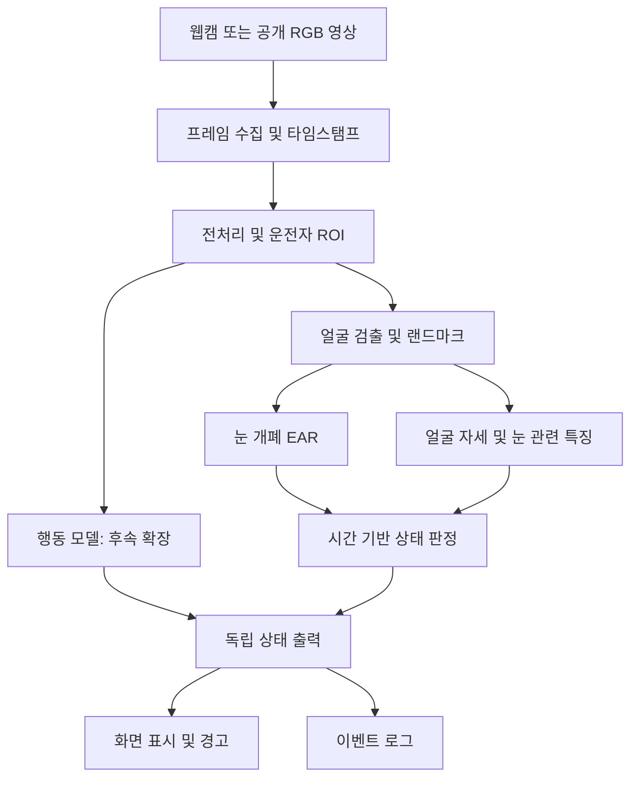

# 가천대 P-실무 | 운전자 상태 인식

**가천대학교 P-실무 5팀의 AI 기반 실시간 운전자 모니터링 시스템(DMS) 개발 프로젝트**

차량 내부 RGB 영상에서 운전자의 졸음 징후와 전방 주시 상태를 추정하고, 핵심 기능이 안정화되면 통화·음료 섭취 등의 행동 인식으로 확장합니다. 일반 PC와 웹캠에서 실행 가능한 연구·교육용 프로토타입을 목표로 합니다.

| 항목 | 내용 |
| --- | --- |
| 과제 | 실시간 운전자 졸음 및 주의 분산 인식을 위한 AI 기반 운전자 모니터링 시스템 개발 |
| 과정 | 가천대학교 AI P-실무프로젝트(캡스톤디자인), 5팀 |
| 계획 기간 | 2026.09.01 ~ 2026.12.21 |
| 개발 우선순위 | ① 졸음·전방 주시 → ② 통화·음료 → ③ 데이터 확보 시 취식·흡연 |
| 문서 기준 | 제공된 과제 계획서 초안, 저장소 초기 구성일 2026.10.21 |

## 현재 개발 상태

이 저장소는 **개발 착수용 초기 구성**입니다. 실제 영상에서 상태를 인식하는 완성된 AI 모델이나 측정 성능은 아직 없습니다. 계획서의 과거 주차 활동도 완료로 간주하지 않습니다.

| 구분 | 현재 제공 | 다음 개발 |
| --- | --- | --- |
| 상태 판정 | 시간 기반 눈 감김·얼굴 방향 규칙, 누락 시 unknown 처리 | 실제 영상 특징 연결, 정면 보정·임계값 검증 |
| 실행 | 합성 특징 CSV → 상태 JSONL 데모 | 웹캠·OpenCV 화면·경고 연결 |
| 데이터 | 운전자 단위 분할 검사 도구, 데이터 관리 지침 | 사용 조건 확인 후 데이터 확보·전처리 |
| 모델 | 얼굴·행동 모듈 인터페이스 | MediaPipe 어댑터, 행동 모델 학습·추론 |
| 평가 | 단위 테스트·CI 구성, 평가 프로토콜·실험 양식 | 실제 테스트셋 성능·FPS·오경보 측정 |

## 시스템 파이프라인



위 그림은 목표 구조입니다. 현재 실행 데모는 **합성 특징 입력 → 시간 기반 상태 판정 → JSONL 로그** 구간입니다. 얼굴 방향은 시선과 다르며 현재 attention 출력은 얼굴 방향 기반 프록시입니다. 실제 시선 추정·졸음 3상태 분류는 별도 데이터와 검증이 필요합니다.

## 빠른 시작

Python 3.10 이상이 필요합니다. 초기 데모와 테스트는 외부 라이브러리 없이 실행됩니다.

```sh
python -m venv .venv
# Windows PowerShell
.venv\Scripts\Activate.ps1
# macOS / Linux: source .venv/bin/activate
python -m pip install -e .
python -m dms --input examples/synthetic_features.csv --output runs/demo.jsonl
python -m unittest discover -s tests -v
python scripts/validate_manifest.py examples/synthetic_manifest.csv
```

예제 입력은 사람·영상·실측 결과를 포함하지 않는 합성 값입니다. 데모 출력은 소프트웨어 연결 확인용이며 AI 성능 근거가 아닙니다. 실행 경로는 저장소 루트를 기준으로 합니다.

## 개발 문서

- [개발 범위와 요구사항](docs/DEVELOPMENT.md)
- [아키텍처·인터페이스](docs/ARCHITECTURE.md)
- [데이터·학습·추론·CI 파이프라인](docs/PIPELINES.md)
- [평가 기준과 목표](docs/EVALUATION.md)
- [단계별 로드맵](docs/ROADMAP.md)
- [데이터 사용 조건과 관리](docs/DATA.md)
- [협업·개발 환경](CONTRIBUTING.md)
- [실험 기록 양식](docs/EXPERIMENT_TEMPLATE.md)
- [기술·데이터 참고 자료](docs/REFERENCES.md)

## 폴더 구조

```text
.github/          # CI, 이슈 및 PR 양식
configs/          # 데모용 상태 판정 설정
docs/             # 개발·파이프라인·평가·일정 문서
examples/         # 합성 입력 및 분할 예제
scripts/          # 데이터 분할 검사
src/dms/          # 모듈 계약·시간 기반 상태 판정·CLI
tests/            # 상태 전이·누락·데이터 누수 검사
data/             # 로컬 데이터 경로 안내; 원본 제외
models/           # 로컬 모델 경로 안내; 가중치 제외
```

## 사용 범위

실차 안전 판단이나 의료적 진단을 위한 제품이 아닙니다. 얼굴 영상·데이터셋 원본·허가되지 않은 가중치·개인정보·비공개 멘토링 원문은 저장소에 포함하지 않습니다. 코드 재사용 라이선스는 팀 협의 후 결정하며, 별도 오픈소스 라이선스는 아직 부여하지 않았습니다.
