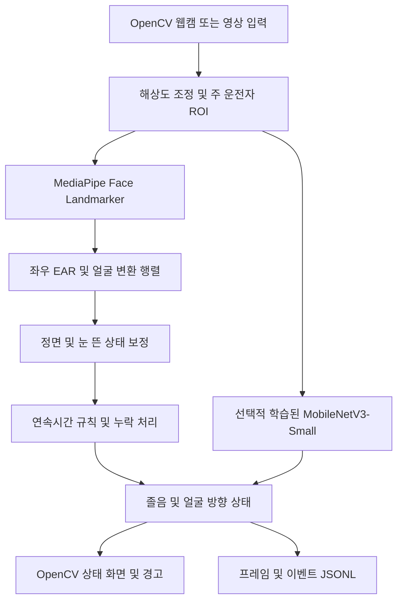

# 실제 아키텍처와 판정 방식

## 실행 경로



## 모듈

| 모듈 | 역할 |
| --- | --- |
| dms.vision | 실제 MediaPipe VIDEO 모드 추론, Observation 생성 |
| dms.calibration | 중립 얼굴 방향·눈 뜬 EAR 보정, 시간 가중 감김 비율 |
| dms.state | 타임스탬프·히스테리시스·연속시간 판정 |
| dms.live | 입력·ROI·화면·이벤트·기록·실행 통계 통합 |
| dms.action | 선택적 과제 학습 체크포인트 로딩·추론 |
| dms.metrics | unknown을 누락시키지 않는 분류 평가 |
| dms.__main__ | 기존 합성 특징 CSV 재생 경로 |

## 얼굴 특징

- **EAR**: 6개 눈 포인트의 두 수직 거리 합 / 수평 거리의 두 배. 정규화 좌표를 픽셀로 변환해 화면 종횡비 왜곡을 줄입니다. 좌우 눈 EAR 평균을 사용합니다.
- **Head Pose**: MediaPipe의 canonical-face-to-detected-face 변환 행렬에서 SVD로 회전 성분을 정리하고 ZYX Euler 각도(yaw/pitch/roll)를 구합니다. 카메라 정면 대비 값은 보정 중앙값과의 차이입니다. 별도 solvePnP/실제 시선 벡터 모델은 사용하지 않습니다.
- **홍채 상대 위치**: 양쪽 눈 모서리 선분에 홍채 중심을 투영한 비율을 진단 로그에 남깁니다. 검증된 gaze 영역 분류기는 아니므로 상태 판정에 사용하지 않습니다.

MediaPipe는 num_faces=2로 모호한 다인 입력을 감지합니다. 이 설정에서 MediaPipe 자체 단일 얼굴 smoothing은 적용되지 않으므로 후단 시간 규칙을 사용합니다. 추적 신뢰도 설정은 검출기 내부 기준이며 프레임별 calibrated confidence를 출력한다고 주장하지 않습니다.

## 보정과 시간 규칙

1. 유효한 단일 얼굴로 최소 15개 표본·2초 이상 보정. 눈 뜬 EAR 및 yaw/pitch 중앙값을 저장합니다. 보정 전 상태는 unknown입니다.
2. 보정 창의 yaw/pitch 표준편차 < 5°, EAR 표준편차 < 0.04일 때 안정된 기준으로 받습니다. 정면·눈 뜬 상태 여부는 사용자 시연 절차의 가정입니다.
3. 눈 감김 시작 임계값 = 보정 EAR × 0.65, 회복 = × 0.80. 연속 감김 1.5초에 suspected. 이 비율은 검증 전 초기 설정입니다.
4. |보정 yaw| > 25° 또는 |보정 pitch| > 20°가 1.5초 지속되면 off_forward. 짧은 회전 대기는 unknown, 정면 복귀는 forward입니다.
5. 얼굴 유실·여러 얼굴·너무 작은 얼굴·과도한 자세는 판단 불가. 기존 경고를 현재 상태로 유지하지 않으며 누적 이력을 초기화합니다.
6. 타임스탬프 간격 > 0.75초면 연속시간 이력을 초기화합니다. 파일은 영상 시간, 카메라는 monotonic capture 시간을 사용합니다. MediaPipe 호출 시 ms는 엄격하게 증가시킵니다.
7. 최근 30초의 관측된 구간에 대해 시간 가중 눈 감김 비율과 관측 coverage를 함께 출력합니다. 누락 시 이력은 초기화합니다. 임상적 PERCLOS나 졸음 3상태 모델이 아닙니다.

## 독립 출력

```json
{"timestamp_s": 4.2, "drowsiness": "suspected", "attention": "forward", "action": "unknown", "source": "mediapipe_ear_pose_v1"}
```

normal은 규칙 경고 미발생을 의미하며 각성 보증이 아닙니다. attention은 얼굴 방향 프록시입니다. 행동은 체크포인트가 없으면 unknown, 연결 시 매 프레임 새 추론을 수행하고 낮은 softmax 점수에서는 보류합니다. softmax는 확률 보정이 된 신뢰도가 아닙니다.

실제 영상 검증 범위와 남은 한계는 [검증 기록](VALIDATION.md)을 참고하세요.
