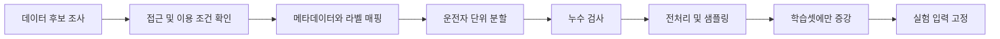

# 개발·데이터·AI 파이프라인

## 1. 현재 실행 가능한 파이프라인

```text
합성 특징 CSV
 → 스키마·타임스탬프 검사
 → EAR/얼굴 방향 연속시간 규칙
 → 독립 상태 및 unknown 처리
 → JSONL 저장
```

```sh
python -m dms --input examples/synthetic_features.csv --config configs/default.json --output runs/demo.jsonl
python scripts/validate_manifest.py examples/synthetic_manifest.csv
```

이 경로에는 얼굴 검출이나 학습된 모델이 없습니다. 합성 CSV의 2.0초에는 졸음 징후 경고, 4.0초에는 얼굴 방향 기반 미주시 상태, 4.5초에는 얼굴 유실 unknown이 출력됩니다.

## 2. 데이터 파이프라인 — 개발 예정



1. 데이터별 출처·사용 목적·허가·재배포·가중치 공개 조건을 `docs/DATA.md` 양식으로 기록.
2. 파일·운전자·촬영 세션·원본 영상·시간·원래 라벨·통합 라벨을 로컬 manifest로 연결.
3. 전처리/프레임 분할 전에 subject 기준 train/val/test를 고정. 같은 영상 인접 프레임을 다른 split에 넣지 않음.
4. 분할 검사 도구로 subject/session 교차 및 sample 중복을 거부. 파일 내용 해시 중복·라벨 균형 검사는 후속 추가.
5. train에서만 데이터 증강·정규화 통계 산출. val로 임계값/모델 선택 후 test는 최종 평가에만 사용.
6. 원본 대신 비식별 메타데이터·분할 해시·전처리 설정·코드 커밋을 기록. 데이터 접근 제한은 유지.

## 3. 학습 파이프라인 — 개발 예정

**얼굴/졸음:** 랜드마크 특징 추출 → 단일 프레임 EAR Baseline → 연속 감김·시간창 비율 → 라벨과의 대응 검증 → 동일 테스트 분할 비교.

**행동:** 확보 클래스 정의 → 상반신 ROI/이미지 정규화 → MobileNetV3-Small 전이학습 → 검증셋 모델 선택 → 클래스별 Recall·Macro F1 → CPU 추론 지연 확인 → 통합 여부 결정.

실험마다 seed, 데이터/분할 버전, 설정, 라이브러리 버전, epoch·batch·optimizer, 하드웨어, checkpoint 해시, 결과를 함께 저장합니다. 실제 학습 명령은 학습 스크립트가 구현된 뒤 추가합니다.

## 4. 실시간 추론 파이프라인 — 개발 예정

웹캠 수집 → 캡처 시간 기록 → 주 운전자 ROI → 얼굴 특징 → 시간 기반 판정 → 필요 주기로 행동 추론 → 상태 결합 → UI·경고·로그.

- 정지 영상과 영상 스트림 모드를 구분하고 MediaPipe 영상 타임스탬프 단위를 맞춤.
- 실제 경과 시간으로 판정하며 처리 프레임 수로 시간을 추정하지 않음.
- 오래된 프레임 누적으로 지연되지 않도록 버퍼/프레임 드롭 정책 정의.
- 행동 모델 처리 주기는 독립 설정, 오래된 행동 출력에는 만료시간 적용.
- 입력 유실·얼굴 미검출·카메라 종료는 화면과 로그에 명시.
- 원본 영상 저장은 기본 비활성. 저장이 필요하면 별도 동의·보관 정책 적용.

## 5. 협업·CI 파이프라인

```text
작업 이슈 → 기능 브랜치 → 구현·로컬 검사 → PR
 → GitHub Actions: 설치·단위 테스트·합성 데모·분할 검사
 → 팀원 리뷰 → main 반영 → 시연·실험 기록
```

`.github/workflows/ci.yml`은 Windows/Linux × Python 3.10/3.12에서 초기 코드 검사를 실행하도록 구성했습니다. GPU 학습·카메라 접근·원본 데이터 다운로드는 CI에 포함하지 않습니다. CI 통과는 코드 동작 검사이며 AI 인식 정확도 인증이 아닙니다.

CI 구성은 [actions/checkout 공식 문서](https://github.com/actions/checkout)와 [actions/setup-python 공식 문서](https://github.com/actions/setup-python)의 사용 예시를 참고합니다.

## 6. 결과물·배포 — 개발 예정

최종 버전 태그 → 검증된 설치 환경 → 권한 확인된 모델 배포 경로 → 공개 데이터 없이 실행 가능한 데모 → 성능표·실패 사례 → 재현 절차 → 발표·결과보고서. 자동 배포와 클라우드 서버 운영은 현재 범위에 포함하지 않습니다.
