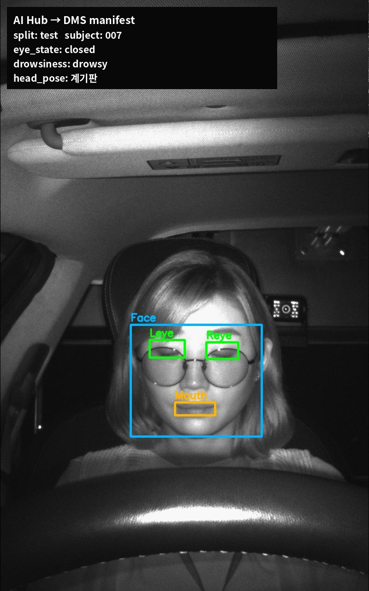

# AI Hub 졸음운전 manifest 변환 결과

변환일: 2026-11-01  
입력: 실제도로·통제환경 bbox 원천/라벨 ZIP 8개  
제외: 준통제환경 keypoint ZIP 4개

## 변환 정책

- 원천 ZIP을 중복 압축 해제하지 않고 archive 경로와 내부 member 경로를 manifest에 기록한다.
- AI Hub 원래 Training/Validation을 그대로 사용하지 않고 환경별 운전자 ID를 합쳐 다시 분할한다.
- 고정 seed 42, subject 비율 70/15/15를 사용한다.
- 좌우 눈이 모두 보이고 open/closed 상태가 일치할 때만 `eye_state` 정답을 생성한다.
- 통제환경 파일명에서 `정상주시/졸음재현`과 주시 방향을 각각 `drowsiness`, `head_pose`로 생성한다.
- 준통제 keypoint에는 직접 상태 정답이 없어 이번 상태 manifest에서는 제외한다.

## 결과

| 항목 | 수량 |
| --- | ---: |
| 읽은 JSON | 323,035 |
| 운전자 | 837 |
| 전체 task 행 | 450,738 |
| eye_state | 300,400 |
| drowsiness | 75,169 |
| head_pose | 75,169 |

### 분할

| Split | 운전자 | Eye | Drowsiness | Head Pose |
| --- | ---: | ---: | ---: | ---: |
| Train | 585 | 209,755 | 52,142 | 52,142 |
| Validation | 125 | 45,328 | 9,933 | 9,933 |
| Test | 125 | 45,317 | 13,094 | 13,094 |

### 주요 라벨 분포

- Eye: open 258,792 / closed 41,608
- Drowsiness: normal 50,215 / drowsy 24,954
- Head Pose: 계기판·네비게이션·룸미러·썬바이저·좌/우 사이드미러·정면 7종, 각 약 10.7천

## 데이터 품질 기록

- 원천 JPG가 없는 JSON 800개는 제외했다.
- JSON member명, `FileInfo.FileName`, 원천 JPG의 액세서리 코드가 다른 사례가 있다.
- 정확한 JSON/JPG member stem을 우선 사용하고, 직접 매칭되지 않는 실제도로 40개는 운전자·세션·프레임과 액세서리 코드 최소 차이로 보정했다.
- 최종 task 행 중 38개가 이 fallback 매칭을 사용했다.
- `metadata_filename_match=False`인 task 행은 939개이며 manifest에 플래그로 보존했다.
- closed가 open보다 적으므로 학습·평가에서 class weight 또는 균형 sampling을 검토한다.

## 출력

- `data/manifests/aihub_drowsiness.csv`
- `data/manifests/aihub_drowsiness.summary.json`

두 파일은 로컬 데이터 경로이며 Git에 포함하지 않는다.

## 적용 예시

- JSON 좌표로 얼굴·좌우 눈·입 영역을 표시했다.
- 양쪽 눈 상태를 `eye_state=closed`, 파일명의 졸음재현과 주시 방향을 각각
  `drowsiness=drowsy`, `head_pose=계기판`으로 변환했다.
- 피험자 `007`은 subject 단위 분할에 따라 test에만 배치했다.
- 원본 데이터 공개 범위는 AI Hub 이용 조건을 별도로 확인해야 하며, 이 이미지는
  프로젝트 내부 구현 기록용 예시로 사용한다.
